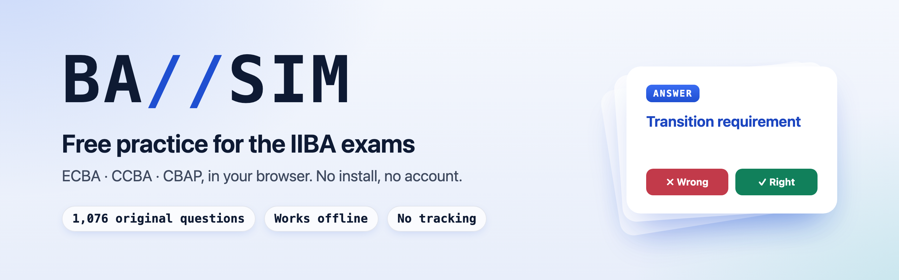
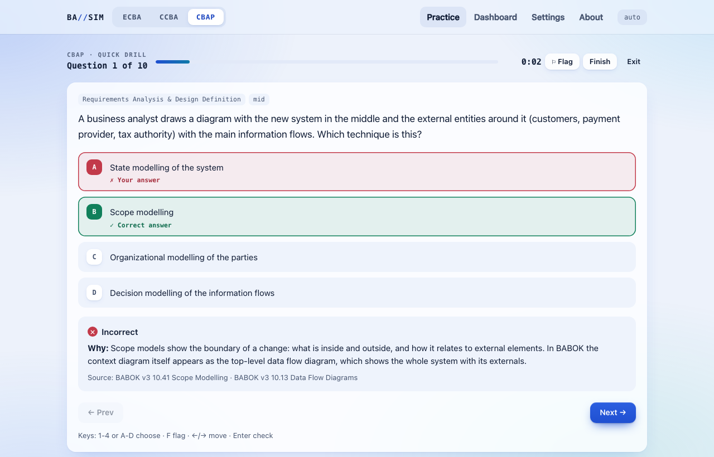
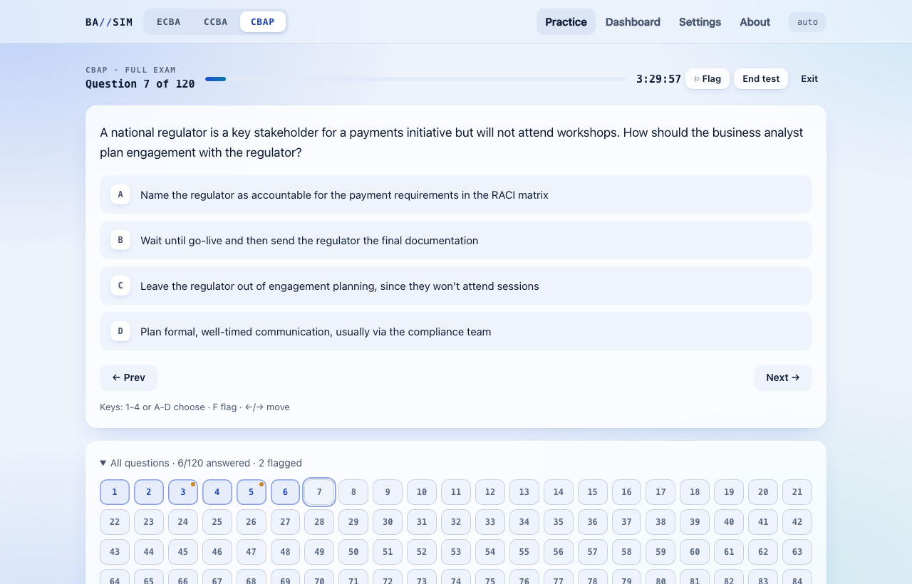
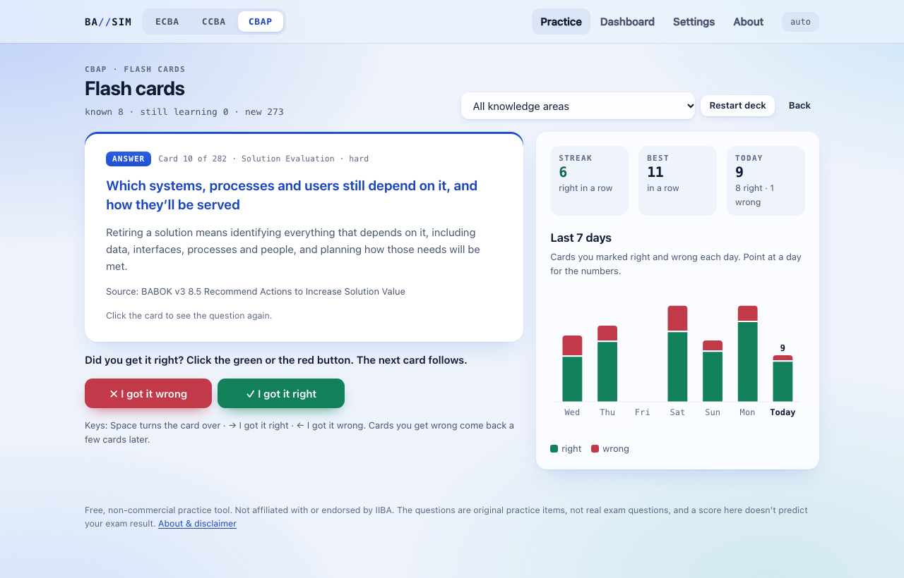
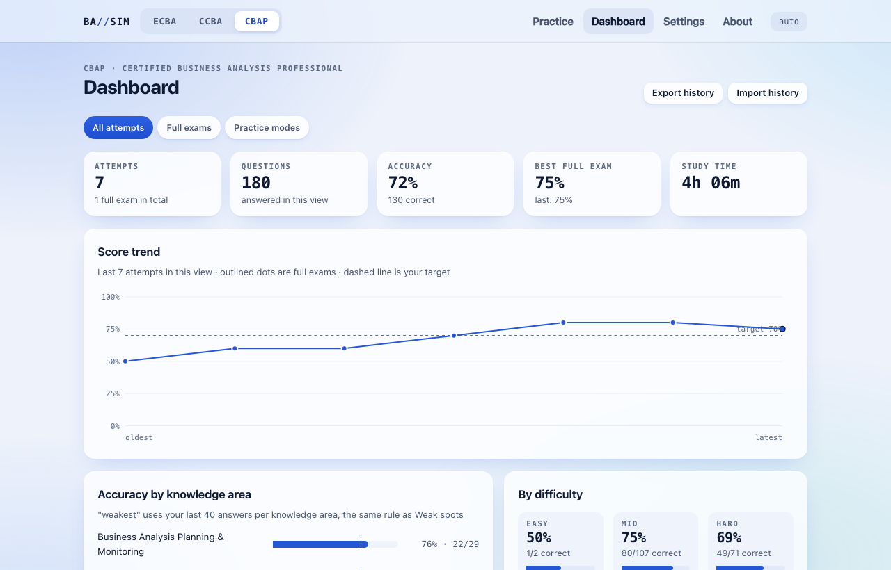

  <a href="https://keyboardmike.github.io/BA-Exam-Sim/">
    <picture>
      <source media="(prefers-color-scheme: dark)" srcset="assets/banner-dark.png">
      
    </picture>
  </a>

<h3 align="center"><a href="https://keyboardmike.github.io/BA-Exam-Sim/">Open the simulator →</a></h3>

  
  
  
  
  
  
  

A free exam simulator for business analysts preparing for the **ECBA**, **CCBA** and **CBAP**. It runs in your browser, with nothing to install and no account, and your results stay on your own device.

<table>
  <tr>
    <td width="50%" valign="top"><picture><source media="(prefers-color-scheme: dark)" srcset="assets/screen-practice-dark.png"></picture> <b>Practice with explanations.</b> Every answer comes with the why and the BABOK section it's based on.</td>
    <td width="50%" valign="top"><picture><source media="(prefers-color-scheme: dark)" srcset="assets/screen-exam-dark.png"></picture> <b>Full mock exams.</b> The real number of questions and the real time, with flags and a review before you submit.</td>
  </tr>
  <tr>
    <td width="50%" valign="top"><picture><source media="(prefers-color-scheme: dark)" srcset="assets/screen-flashcards-dark.png"></picture> <b>Flash cards with a streak.</b> Turn the card over, say if you got it right, and watch your week build up.</td>
    <td width="50%" valign="top"><picture><source media="(prefers-color-scheme: dark)" srcset="assets/screen-dashboard-dark.png"></picture> <b>See your progress.</b> Scores over time, accuracy by area, and your weakest area marked.</td>
  </tr>
</table>

---

## Why this exists

I'm a business analyst, and I care a lot about this craft and the people who practise it. Preparing for an IIBA exam is a big investment. The exam fees are only the start: practice question banks cost money, they expire after a few months, and most of them don't show you where you're actually weak.

So I built the tool I wanted for my own preparation, and I'm sharing it with the community. It's free, it will stay free, and it's not for sale. If it helps you pass, that's the whole point.

---

## How it helps you prepare

From my own experience: the more you know about your weak spots, the better you can focus on them. That's what this simulator is for.

1. **Answer questions.** Every answer is recorded, area by area.
2. **Get some wrong.** That's the useful part. The questions you miss show you which areas are weak, and the Dashboard marks your weakest one.
3. **Close the gap.** Go back to that area. Read the BABOK section the explanations cite, write it down in your own words, ask questions, and get someone to explain what still doesn't make sense.
4. **Test it again.** Use Weak spots, Knowledge area focus and drills on that area until the gap is filled.
5. **Find the next one.** Something else is now your weakest area. Focus on that.

Keep going until your results are evenly spread across every area, at a level you're comfortable with. Your score shows you where to go next. It doesn't predict your exam result.

---

## What's inside

| Exam | Questions in the simulator | The real exam |
|---|---|---|
| ECBA | 455 | 50 questions in 75 minutes, across 9 domains |
| CCBA | 315, including 3 case studies | 130 questions in 180 minutes |
| CBAP | 306, including 5 case studies | 120 questions in 210 minutes |

- Every question explains why the right answer is right, and cites the section of the BABOK Guide (or The Business Analysis Standard) it's based on.
- Full exams follow IIBA's published weighting of each knowledge area, so you practise the same mix as the real exam.
- Some questions are long on purpose: 30% of the ECBA questions, 35% of the CCBA and 40% of the CBAP are scenarios of 60 to 110 words, and each case study is about 330 words. They aren't harder, just longer, so you practise managing your time and your reading pace, not only knowing the answer.
- 50 **Match** puzzles on how the BABOK Guide fits together: you sort its tasks, their outputs and short descriptions of real analyst work into knowledge areas and tasks, from two boxes up to the whole map. The task and output names are the BABOK Guide's; the activities are original.
- A **day streak** counts the days in a row you practise, and **Biggest improvement** records your best jump in one area.
- It works on a laptop, a tablet or a phone, in light or dark mode.

---

## Seven ways to practise

| Mode | What it does | Use it when |
|---|---|---|
| **Full exam simulation** | The real number of questions against a countdown. Flag questions for review. Answers and explanations come at the end. | You want a realistic mock exam. |
| **Quick drill** | 10 questions from across the exam, the ones you haven't seen first. The answer and the why after each one. | You have 15 minutes. |
| **Weak spots** | 10 questions from your weakest area, starting with the ones you got wrong. | You've done some practice and want to fix what isn't sticking. |
| **Knowledge area focus** (domain focus for the ECBA) | 20 questions from one area you choose. | You've just studied a chapter. |
| **Hard 10** | 10 of the hardest questions. | You feel confident and want a challenge. |
| **Flash cards** | See the question, turn the card over, and say whether you got it right. Builds a streak, with a chart of the last 7 days. | You want to learn terms and concepts on the go. |
| **Match** | 50 sorting puzzles: put each task, output or activity in the right knowledge area or task. Four levels, from two boxes to the whole map, with stars and best times. | You want to see how the BABOK Guide fits together. |

After any test, **Retry incorrect** runs the questions you missed again.

---

## Quick start: your first 10 minutes

1. Open the simulator and choose your exam in the tabs at the top: **ECBA**, **CCBA** or **CBAP**.
2. Read the **Before you start** note, then click **Got it**.
3. Click **Start drill** on the Quick drill card.
4. Pick an answer and click **Check answer**. Read the explanation and note the BABOK section under it. That's where to look if it didn't click. In the **All questions** panel, checked questions turn green when you were right and red when you were wrong.
5. Click **Next** until you reach the end, then **See results**: your score, your score per area, and every question with its answer.
6. Click **Retry incorrect** to go again on the ones you missed, or open the **Dashboard** to see your progress.

---

## How to…

### Take a full mock exam
- Click **Start exam**. The countdown is the real exam time.
- Not sure about a question? Click **Flag** (or press **F**) and come back to it. The **All questions** panel shows which ones are answered and which are flagged.
- When you're done, click **End test**. You'll see a list of your flagged and unanswered questions before you **Submit exam**. Unanswered questions count as wrong.
- When the time runs out, the exam is submitted automatically.
- Need a break? **Exit** saves the exam, and the clock stops until you **Resume** from the Practice page. The real exam doesn't pause.

### Find your weak spots
- After you've answered at least 5 questions in an area, the **Dashboard** marks your weakest area, and the **Weak spots** card unlocks.
- **Weak spots** gives you 10 questions from that area, starting with the ones you got wrong. **Knowledge area focus** lets you pick any area yourself.

### Use flash cards
- Click **Open cards**, and choose all areas or just one.
- Read the question and answer it in your head. Then click **Show answer**, and the card turns over. Long scenario questions appear on the cards in a short version, so you can go through them quickly.
- Be honest with yourself: click the green **I got it right** or the red **I got it wrong**. The next card follows straight away.
- Cards you got wrong come back a few cards later. Cards you know move to the back of the deck next time.
- Next to the card you'll see your **streak** (right answers in a row), your best streak, today's right and wrong, and a chart of the **last 7 days**.

### Play the Match puzzles
- Click **Open puzzles** on the Practice page. Start with #1. They begin with two boxes and a few cards and build up to the whole map.
- Click or tap a card, then the box it belongs in. With a mouse you can drag it instead. On a phone, a bar at the bottom lists the boxes.
- When every card is placed, click **Check**. Right cards stay put with a tick; wrong ones go back to the pile, marked, for another go.
- Three stars for no mistakes, two for one or two. **Show answers** finishes a puzzle without stars.
- At the end, **Worth a second look** explains every card you got wrong. Click any card to see why it goes where it does.
- Some boards have an extra box, such as **Not a BABOK v3 task**: a few cards are old BABOK v2 task names or project work.

### Keep a streak going
- Each day you practise counts towards your **day streak**: finish a test or drill, rate a flash card, or finish a Match puzzle. The Practice page shows it, with your best.
- Miss a day and the streak goes back to 0. The Practice page tells you how long your last one was, and you start again the next time you practise.
- When a test beats your recent score in an area by 5 points or more, the results page tells you, for example **Strategy Analysis: 20% → 45%**. It counts areas with at least 5 questions in the test, compared with your last 40 answers there.
- Your best jump so far is your **Biggest improvement**, on the Dashboard under **Personal bests**.

### Read your dashboard
- **Personal bests:** your day streak, your best streak and your biggest improvement.
- **Score trend:** your scores over time. The dashed line is your practice target.
- **Accuracy by area:** where you're strong, and which area is your weakest.
- **By difficulty** and **Bank coverage:** how you do on easy, mid and hard questions, and how much of the bank you've seen.
- **History:** every test you've taken. Click **Review** to see it again.

### Move your results to another device
- On the **Dashboard** (or in **Settings**), click **Export history**. You get a small file.
- On the other device, open the simulator and click **Import history**. Tests that are already there are skipped.
- Export now and then as a backup: clearing your browser data deletes your history.

### Change how it works
In **Settings** you can:
- turn off the answer after each question in practice modes, so they feel more like the exam
- turn off shuffling of the answer options
- set your own practice target (70% by default)
- clear all your data

The button at the top right switches between automatic, dark and light mode.

### Keyboard shortcuts

| While answering | |
|---|---|
| **1** to **4**, or **A** to **D** | Choose an answer |
| **Enter** | Check your answer (practice modes) |
| **F** | Flag the question |
| **←** **→** | Previous or next question |

| Flash cards | |
|---|---|
| **Space** | Turn the card over |
| **→** | I got it right |
| **←** | I got it wrong |

| Match puzzles | |
|---|---|
| **Tab**, then **Enter** | Pick up a card |
| **1** to **7** | Put it in that box |
| **0** | Put it back in the pile |
| **Esc** | Let go of the card |

---

## Your data stays with you

- Everything is saved in your own browser on your own device. There are no accounts, no tracking and no cookies, and nothing is sent to a server.
- Each browser keeps its own history. To continue on another device, export and import it (see above).
- In a private or incognito window, results disappear when you close it.
- GitHub, which hosts the page, may keep standard technical logs of visits.

Want to practise without internet, say on a plane? Download this repository (**Code → Download ZIP**), unzip it and open `index.html`. It works fully offline.

---

## About the questions

- They're original practice questions, written against the BABOK Guide v3 and, for the ECBA's foundation domains, The Business Analysis Standard. They were written with the help of AI, then checked against the BABOK Guide text.
- Each explanation is in plain words, not copied from the Guide, and cites the section it's based on, so you can check it yourself.
- The wrong answers were reviewed to be believable, so test-taking tricks like "pick the longest answer" don't work.
- They are **not** real exam questions, and they may not match the real exam's wording or difficulty.
- The **About** page shows how many questions each exam and area has.

**Found a mistake?** Please open an [Issue](../../issues) with the question text, the answer you think is right, and the BABOK section. If the simulator and the BABOK Guide disagree, the BABOK Guide is right.

---

## Disclaimer

- **Free and non-commercial.** Free for personal study, and free to share. Please don't sell it, charge for access to it, or include it in paid courses, products or services.
- **Not affiliated with IIBA.** This is an independent project, not affiliated with, endorsed, sponsored or reviewed by the International Institute of Business Analysis (IIBA). IIBA, BABOK, ECBA, CCBA, CBAP and BACCM are trademarks of IIBA, used here only to describe what the questions cover.
- **Practice questions only.** None of the questions come from an IIBA exam.
- **Your score is not a prediction.** A high score doesn't mean you'll pass, and a low one doesn't mean you'll fail. Scores also rise as you remember questions. IIBA doesn't publish a pass mark; the 70% target is a common community estimate, not an official number.
- **Check exam details with IIBA.** Exam formats, timing, blueprints and eligibility rules change. Always check IIBA's current certification handbook before you book. Using the simulator doesn't count toward IIBA's professional development hours.
- **Mistakes can happen.** The questions were checked carefully, but errors are possible. If an answer disagrees with the BABOK Guide, the BABOK Guide is right.
- **No real exam content.** Never share or add questions from a real IIBA exam. Candidates agree to keep the exam confidential, and sharing exam content can put certifications at risk.
- **Names are made up.** The companies, organizations, places and people in the questions and case studies are invented. Any resemblance to a real company, organization or person is purely coincidental, and no real one was meant.
- **No warranty.** The simulator is provided as is. The author isn't responsible for exam results, study or career decisions, or anything else that follows from using it.

---

Good luck with your exam. I hope this helps you get there.
